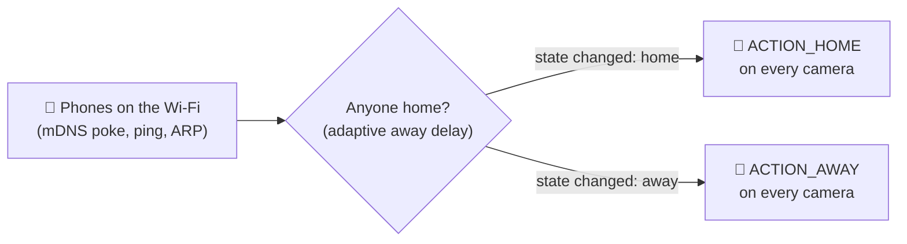

# tapo-watcher

[](../../actions/workflows/ci.yml)


**Turn your TP-Link Tapo C210 cameras away when you are home and back to the
door when you leave — automatically, based on your phones being on the Wi-Fi.**

| Someone is home | Everybody left |
| --- | --- |
| Cameras run `ACTION_HOME` — e.g. a preset facing a wall, or privacy mode on | Cameras run `ACTION_AWAY` — e.g. a preset facing the entrance |



## Features

- **Local only, no root** — runs on any Linux box on the same LAN
  (Raspberry Pi, NAS, home server) and talks to the cameras locally through
  [pytapo](https://github.com/JurajNyiri/pytapo).
- **Several phones**: one phone at home is enough to count as "home".
- **Several cameras**, each with its own account and actions
  ([details](#several-cameras)).
- **Sleeping iPhones handled**: Wi-Fi wake-up poke + ARP check, and an away
  delay **learned per phone** to avoid false departures
  ([details](#adaptive-away-delay)).
- **The IP follows the MAC**: a phone that gets a new DHCP lease is found again.
- **Moves only on change**, and a camera whose action failed is retried alone.
- **One-command install** with an interactive script ([details](#2-easy-way-installsh)).

## Contents

- [Installation](#installation)
  - [Before you start](#1-before-you-start)
  - [Easy way: `install.sh`](#2-easy-way-installsh) (recommended)
  - [Manual way](#3-manual-way)
- [Configuration](#configuration) · [Several cameras](#several-cameras) · [Actions](#actions)
- [Usage](#usage)
- [How detection works](#how-detection-works)
- [Troubleshooting](#troubleshooting)
- [Development](#development)

## Installation

**Requirements:** Linux on the same LAN as the phones (ARP does not cross
routers or guest networks), `ping` and `ip` (iproute2), and
[uv](https://docs.astral.sh/uv/), which installs Python 3.9+ and
[pytapo](https://github.com/JurajNyiri/pytapo) for you.

```bash
git clone https://github.com/atao/tapo-watcher.git ~/tapo-watcher
cd ~/tapo-watcher
```

### 1. Before you start

Gather this first — the installer will ask for it.

**Cameras** — in the Tapo app, for each camera:

- Create a **camera account**: Camera → Settings → Advanced Settings → Camera
  Account (not your TP-Link cloud email). Note the username and password.
- Note the camera **IP address** (a static DHCP lease is recommended).
- Save the positions you want as **presets** (Pan/Tilt → Saved positions), e.g.
  `Home` (facing a wall) and `Away` (facing the entrance). You can also do it
  later from the command line, see [Usage](#usage).

**Phones** — for each phone:

- **iPhone**: Settings → Wi-Fi → (i) → *Private Wi-Fi Address* = **Off** or
  **Fixed** (never *Rotating*). Note the **MAC address** shown there.
- The IP is optional: it is resolved from the MAC. A static DHCP lease (e.g.
  Pi-hole → Settings → DHCP → Static DHCP leases) just avoids a subnet ping
  sweep when a phone changes IP.

### 2. Easy way: `install.sh`

```bash
./install.sh
```

Run it as your normal user (not root). It asks its questions, then sets
everything up:

1. **Checks** that `systemctl`, `uv`, `ping` and `ip` are available.
2. **Asks** for the cameras (how many, shared account or not, then name, IP,
   username / password and home / away actions of each), the phones (MAC and
   optional IP) and the timing (`INTERVAL`, `AWAY_AFTER_MISSES`,
   `ADAPTIVE_DELAY`). Answers are validated; passwords are typed hidden, asked
   twice and never displayed (they cannot contain a single quote `'`).
3. **Writes `tapo.env`** at mode 600 after showing a summary.
4. **Tests** phone detection (`--check`) and, if you accept, the camera
   connection (`--presets`, read-only).
5. **Installs the systemd user service** with the right paths and starts it if
   you accept — the cameras then move to the current state.
6. **Offers `loginctl enable-linger`** (sudo) so the service keeps running when
   you are logged out.

Then follow it with `journalctl --user -u tapo-watcher -f`.

**Reconfigure:** run `./install.sh` again. The current values are offered as
defaults, the previous file is kept as `tapo.env.bak`, and advanced settings
(`AWAY_MIN`, `AWAY_MAX`, `ADAPTIVE_MARGIN`, `ADAPTIVE_EXTRA_CHECKS`,
`ADAPTIVE_MIN_SAMPLES`, `STATE_FILE`) are preserved.

**Update:**

```bash
./install.sh update
```

Pulls the latest version (`git pull --ff-only`, refused if tracked files were
edited locally), lists the new commits, syncs the dependencies, rewrites the
systemd unit if it changed, restarts the service and shows its first log
lines. `tapo.env` and the learned delays are kept. Nothing is restarted when
already up to date.

**Uninstall:**

```bash
./install.sh uninstall
```

Stops and removes the service, then asks (default: no) before deleting
`tapo.env`, the learned delays (`tapo-watcher.state.json`), `.venv` and before
disabling linger.

### 3. Manual way

```bash
uv sync                          # creates .venv from uv.lock
cp tapo.env.example tapo.env
chmod 600 tapo.env               # it contains camera passwords
$EDITOR tapo.env                 # see Configuration below
uv run tapo_watcher.py --check   # phone detection test
uv run tapo_watcher.py --presets # camera test (read-only)
```

Run it as a service: `tapo-watcher.service` is a systemd user unit running
`uv run --frozen` (edit the paths if the project is not in `~/tapo-watcher` or
uv is not in `~/.local/bin`):

```bash
mkdir -p ~/.config/systemd/user
cp tapo-watcher.service ~/.config/systemd/user/
systemctl --user enable --now tapo-watcher
journalctl --user -u tapo-watcher -f
sudo loginctl enable-linger "$USER"   # keep running when logged out
```

## Configuration

Everything lives in `tapo.env` (written by `install.sh`, or copied from
[`tapo.env.example`](tapo.env.example)). It is loaded automatically from the
script's directory; variables already set in the environment take precedence,
and `TAPO_ENV_FILE=/path/to/file` loads another file.

| Variable | Description | Default |
| --- | --- | --- |
| `PHONES` | Comma-separated `ip=mac` list. IP or MAC may be omitted (`=mac`, `ip=`). | required |
| `CAMERA_IP` | Camera IP address (single camera, ignored when `CAMERAS` is set) | required |
| `CAMERA_USER` | Camera account username (default for every camera) | `admin` |
| `CAMERA_PASSWORD` | Camera account password (default for every camera). Wrap in single quotes if it contains `$`. | |
| `ACTION_HOME` | Action when a phone is home (default for every camera) | `preset:Home` |
| `ACTION_AWAY` | Action when all phones are away (default for every camera) | `preset:Away` |
| `CAMERAS` | Comma-separated camera names, for several cameras (see below) | |
| `INTERVAL` | Seconds between checks | `30` |
| `AWAY_AFTER_MISSES` | Failed checks before "away" (fixed delay, or until enough silences are learned) | `6` |
| `ADAPTIVE_DELAY` | Learn the away delay per phone (`1`/`0`) | `1` |
| `AWAY_MIN` | Minimum learned away delay (s) | `60` |
| `AWAY_MAX` | Maximum away delay (s); longer silences are real absences | `1200` |
| `ADAPTIVE_MARGIN` | Safety factor applied to the 95th percentile | `1.2` |
| `ADAPTIVE_EXTRA_CHECKS` | Missed checks tolerated on top of the 95th percentile | `2` |
| `ADAPTIVE_MIN_SAMPLES` | Silences needed before using the learned delay | `5` |
| `STATE_FILE` | Where learned silences are stored | `tapo-watcher.state.json` |

`PHONE_IP` / `PHONE_MAC` are still accepted for a single phone.

### Several cameras

List the camera names in `CAMERAS`, then configure each one with variables
named after it (`<NAME>` = name in upper case, non-alphanumerics replaced by
`_`, so `living-room` → `LIVING_ROOM`):

| Variable | Description | Default |
| --- | --- | --- |
| `CAMERA_<NAME>_IP` | Camera IP address | required |
| `CAMERA_<NAME>_USER` | Camera account username | `CAMERA_USER` |
| `CAMERA_<NAME>_PASSWORD` | Camera account password | `CAMERA_PASSWORD` |
| `CAMERA_<NAME>_ACTION_HOME` | Action when a phone is home | `ACTION_HOME` |
| `CAMERA_<NAME>_ACTION_AWAY` | Action when all phones are away | `ACTION_AWAY` |

```bash
CAMERAS=salon,entrance
CAMERA_PASSWORD='shared-password'
CAMERA_SALON_IP=192.168.1.100
CAMERA_ENTRANCE_IP=192.168.1.101
CAMERA_ENTRANCE_ACTION_HOME=privacy:on
CAMERA_ENTRANCE_ACTION_AWAY=privacy:off
```

Phones are checked once per loop for all cameras. Every camera is tried on
each state change; if one fails (unreachable, wrong password…), only that one
is retried on the next check — the others are not moved again.

### Actions

| Action | Effect |
| --- | --- |
| `preset:<name or id>` | Go to a saved position (disables privacy mode first) |
| `move:<x>,<y>` | Relative motor move — drifts over time, prefer presets |
| `privacy:on` / `privacy:off` | Toggle privacy mode (lens cover) |
| `none` | Do nothing |

## Usage

```bash
uv run tapo_watcher.py --check     # print whether a phone is connected
uv run tapo_watcher.py --presets   # list camera presets (every camera)
uv run tapo_watcher.py --presets --camera salon   # one camera only
uv run tapo_watcher.py --once      # one check + action (add --camera NAME for one camera)
uv run tapo_watcher.py --stats     # learned away delay per phone
uv run tapo_watcher.py             # run forever (what the service does)
```

Save the current position of a camera as a preset (`tp.camera()` is the first
camera; use `tp.camera(tp.select_cameras('salon')[0])` for another one):

```bash
uv run python -c "import tapo_watcher as tp; print(tp.camera().savePreset('Away'))"
```

## How detection works

Every `INTERVAL` seconds, for each phone in `PHONES`:

1. Send a few UDP packets to port 5353 (mDNS) to wake a sleeping iPhone's Wi-Fi.
2. Ping it.
3. Check the kernel ARP table (`ip neigh`): a fresh `REACHABLE`/`DELAY`/`PROBE`
   entry counts as present, since iPhones often ignore ping but still answer ARP.
4. If a MAC is configured, the ARP entry must match it.

**The IP follows the MAC.** A phone is identified by its MAC; the IP in
`PHONES` is only a starting hint. If the phone is not found at its last known
IP (DHCP gave it a new one, or no IP was configured), the script looks the MAC
up in the ARP table — pinging the cameras' /24 first if needed — and remembers
the new IP (logged as `new IP`). `tapo.env` is never rewritten.

### Adaptive away delay

A sleeping iPhone can stay silent on the network for minutes, so a phone is
not declared **away** as soon as it stops answering. Each phone has its own
away delay, learned automatically:

1. When a phone misses at least one check and then answers again within
   `AWAY_MAX` (20 min by default), that silence is recorded in
   `tapo-watcher.state.json`. Longer silences are real absences and are ignored.
2. Once `ADAPTIVE_MIN_SAMPLES` silences are recorded, the away delay is the
   95th percentile of the last 200 silences × `ADAPTIVE_MARGIN`, or that
   percentile + `ADAPTIVE_EXTRA_CHECKS` × `INTERVAL` if longer, clamped to
   [`AWAY_MIN`, `AWAY_MAX`]. The extra checks matter for short silences: a
   phone that usually misses one check (~65 s) gets ~125 s instead of ~78 s,
   so missing two checks in a row does not turn the camera.
3. Before that, `AWAY_AFTER_MISSES` × `INTERVAL` is used.

The learned data survives restarts. Check it with:

```bash
uv run tapo_watcher.py --stats
```

Delete `tapo-watcher.state.json` to start learning again (e.g. after
changing phone). Set `ADAPTIVE_DELAY=0` to always use the fixed delay.

## Troubleshooting

- **Phone always "absent"**: check that its MAC appears in `ip neigh` while it is
  on Wi-Fi, that the private address is not *Rotating*, and that it is not on a
  guest network.
- **"new IP" in the logs**: the phone changed IP; detection followed it via
  its MAC. Set a static DHCP lease if it happens often.
- **Camera auth error**: use the camera account from the Tapo app, not your
  TP-Link cloud email.
- **Camera does not move**: privacy mode blocks motion; `preset:` and `move:`
  turn it off automatically.
- **One camera out of several does not move**: the logs show
  `Camera <name>: action failed`; it is retried on every check. Test it alone
  with `uv run tapo_watcher.py --presets --camera <name>`.

## Development

```bash
uv sync                 # installs dev tools too (pytest, ruff)
uv run pytest           # tests (no network, camera or tapo.env needed)
uv run ruff check .     # lint
uv run ruff format .    # format
```

GitHub Actions (`.github/workflows/ci.yml`) runs ruff and the tests on Python
3.9, 3.12 and 3.13 for every push to `main` and every pull request.

Managing dependencies:

```bash
uv add <package>        # add a dependency (updates pyproject.toml + uv.lock)
uv lock --upgrade       # upgrade pinned versions
uv sync                 # install exactly what uv.lock says
```
